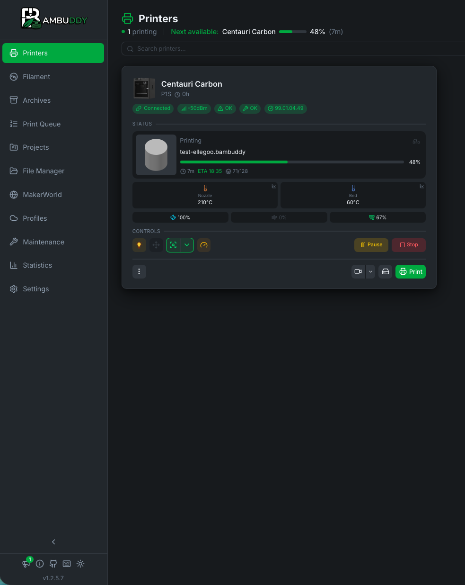
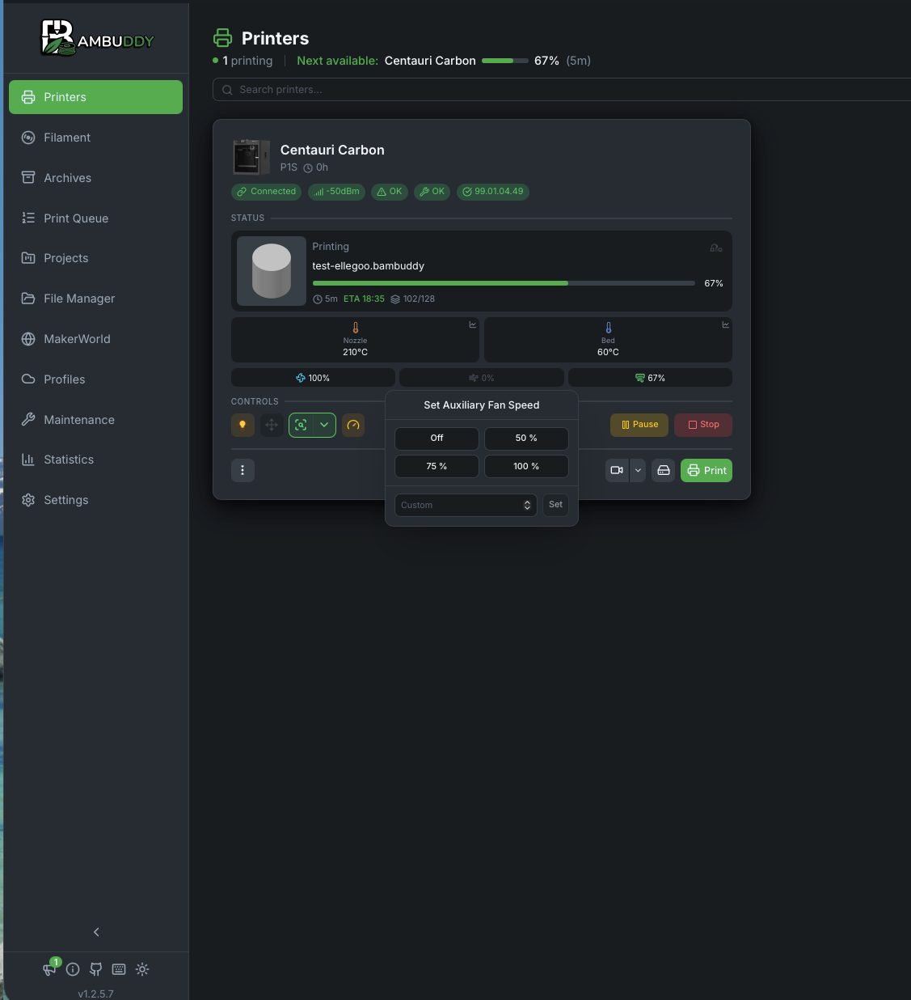
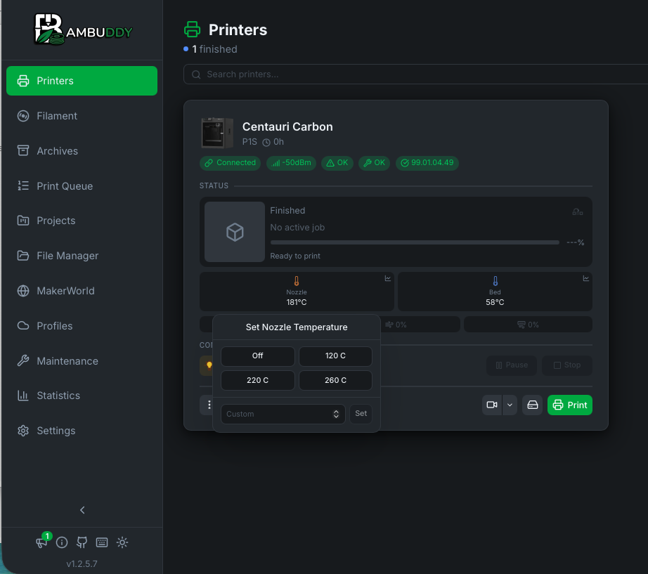
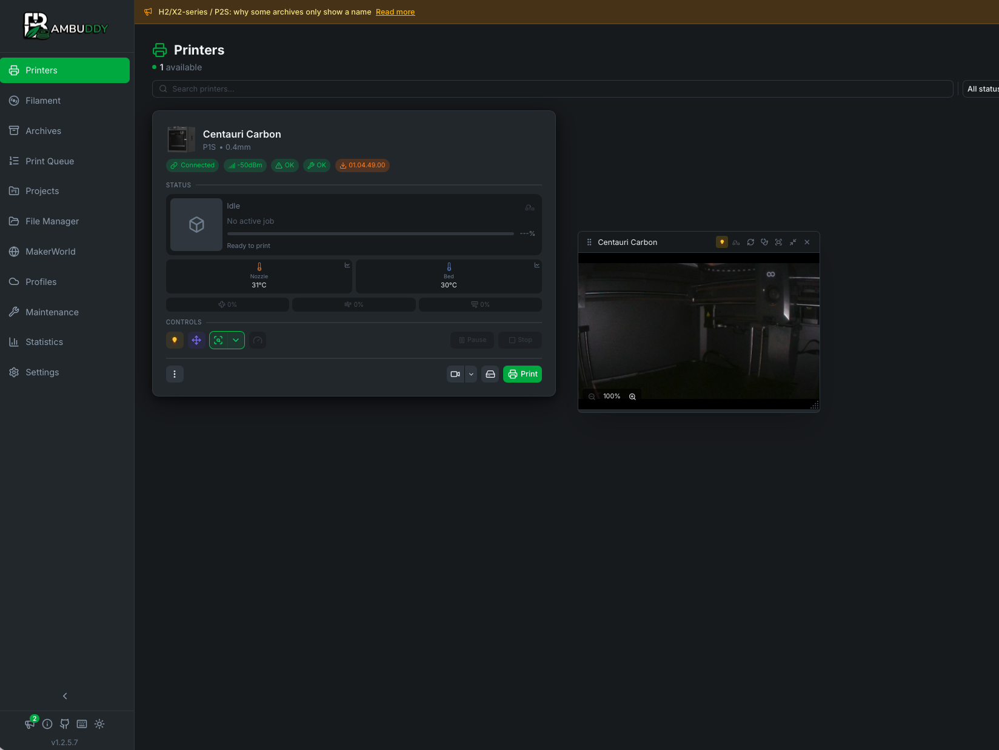
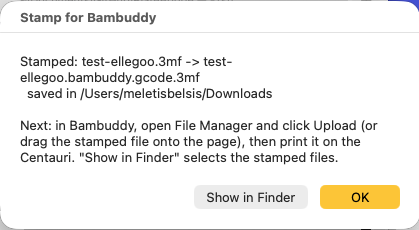

# ElegooBridge

**Lets [Bambuddy](https://github.com/maziggy/bambuddy) manage an Elegoo Centauri
Carbon alongside Bambu Lab printers.**

ElegooBridge runs in Docker next to Bambuddy. It talks to the Centauri in its own
protocol (SDCP over a local WebSocket) and presents it to Bambuddy as a Bambu LAN
printer. Bambuddy itself is not modified.

```
Bambuddy  --MQTT/TLS :8883-->  Mosquitto  <-->  ElegooBridge  --SDCP :3030-->  Centauri Carbon
          --FTPS :990------------------------->  (uploads)    --HTTP :80---->  (G-code)
         (sees a Bambu P1S)
```

Version **0.3.0**. Tested with Bambuddy and a Centauri Carbon (firmware V1.4.49),
including a print sent from Bambuddy's queue.

> **Before printing from Bambuddy:** sliced files must be stamped first, on your
> own computer, with the **Stamp for Bambuddy** Mac app (drag and drop) or a
> Python script. See [Printing from Bambuddy](#printing-from-bambuddy).

## Screenshots

The Centauri Carbon in Bambuddy, through ElegooBridge:

| Printing a file sent from Bambuddy's queue | Fan control during a print |
| --- | --- |
|  |  |

| Temperature control after a finished print | Live camera |
| --- | --- |
|  |  |

## What works

| In Bambuddy | Status |
| --- | --- |
| Live card: state, progress, layers, remaining time, file name | ✓ |
| Nozzle, bed and chamber temperatures | ✓ |
| Preparation stages (heating, homing, levelling) | ✓, as close as the Centauri reports them |
| Finished and failed jobs, including power loss mid-print | ✓ |
| **Filament runout:** reported as Bambu error `0300_8004`, "Filament ran out" | ✓ |
| Pause, resume, stop | ✓ |
| Nozzle and bed temperature, part / auxiliary / chamber fans, chamber light, speed level | ✓ |
| Home and X/Y/Z jog (the printer must be homed before jogging) | ✓ |
| **Camera**, built in: live view and snapshots, as a P1S camera on port 6000. Any number of viewers share one connection to the printer, which allows only four. | ✓ |
| Offline when the Centauri is off (after Bambuddy's 60 s timeout) | ✓ |
| **Printing from Bambuddy** (library, queue): files must be stamped, see below | ✓ |
| A refused print shows on the card at once as a failed job with a Bambu error, e.g. `0500_4037` "not compatible with current printer model" | ✓ |
| File manager: the files Bambuddy uploaded | ✓ |
| Extruder jog, AMS / CANVAS, the Centauri's own stored files, other G-code | No |

The bridge is tested against a fake Centauri. The Centauri commands it uses were
each tested on a real Centauri Carbon, firmware V1.4.49: see
[`docs/FINDINGS.md`](docs/FINDINGS.md).

## Set up

You need Docker, and the Centauri on the same network.

1. **Find the printer**, from this folder:
   ```sh
   python3 -m elegoobridge discover
   ```
   It prints the IP and `PRINTER_MAINBOARD_ID`.
2. **Configure:** copy `.env.example` to `.env` and fill it in. `ACCESS_CODE` is a
   password you choose; Bambuddy will use it.
3. **Create the TLS certificate**, once:
   ```sh
   ./scripts/make-certs.sh
   ```
4. **Start it:**
   ```sh
   docker compose up -d --build
   docker compose logs -f bridge
   ```
5. **Add the printer in Bambuddy:**

   | Field | Value |
   | --- | --- |
   | Model | **P1S**: enclosed, same 256 mm build volume, and the same three fans |
   | IP address | The computer running ElegooBridge, **not** the printer |
   | Serial number | `BAMBU_SERIAL` from `.env` |
   | Access code | `ACCESS_CODE` from `.env` |

**One bridge per printer.** Bambuddy expects each printer on its own IP address
with port 8883, so a second Centauri needs a second host or IP address.

## Printing from Bambuddy

> **Important: stamp every file before you add it to Bambuddy.**
> Files from ElegooSlicer (or OrcaSlicer with a Centauri profile) can't be printed
> from Bambuddy as they are. Stamp them first, each time you export: drop them on
> the **Stamp for Bambuddy** Mac app, or run the Python script. Both run on your
> own computer, where you slice, not in Docker.

### Why

Bambuddy only sends a file to a printer of the same model it was sliced for. The
bridge shows the Centauri to Bambuddy as a **P1S**, but a file sliced for the
Centauri says **"Elegoo-CC"**. Without the stamp, Bambuddy refuses to print it,
with a message like:

> test.gcode.3mf was sliced for Elegoo-CC and cannot be dispatched to P1S printers

The stamp changes only that label, to P1S, so Bambuddy accepts the file.

### How: the three steps

1. **Slice for the Centauri.** In ElegooSlicer, or OrcaSlicer with a Centauri
   Carbon profile, slice the plate, then choose **File → Export → Export plate
   sliced file**. You get a `.gcode.3mf` file. A project saved with **Save
   project** has no G-code and can't be stamped. The menu item is greyed out
   until the plate is sliced.
2. **Stamp it**, with the Mac app or the Python script (both below). The stamped
   copy is saved **next to the original**, with `.bambuddy.gcode.3mf` at the end:
   `~/Downloads/cube.gcode.3mf` → `~/Downloads/cube.bambuddy.gcode.3mf`.
3. **Add the stamped file to Bambuddy.** Open **File Manager** in the left sidebar
   → **Upload**, or drag the file onto that page. Then select it → **Print** →
   **Centauri Carbon**. If asked about AMS slots, choose the external spool.

### Stamping with the Mac app (easiest)

**Stamp for Bambuddy.app** is a drag-and-drop app. Build it once, in this folder;
it needs only macOS:

```sh
./stamp/build-mac-app.sh
```

It's created in `stamp/dist/Stamp for Bambuddy.app`. Move it to **Applications**,
or drag it into the Dock. Then:

- **Drop** one or more sliced `.gcode.3mf` files, or a whole folder, onto the app.
- Or **double-click** the app and choose the files.

A window shows what was stamped and where it was saved. **Show in Finder** selects
the stamped files, ready to drag into Bambuddy.



If a file can't be stamped, for example a project without sliced G-code or a file
for another printer, the window says why and what to do instead.

The first time you open it, macOS may say it can't verify the developer. Right-click
the app → **Open** → **Open**. It's built and signed on your own Mac, not
notarised by Apple.

### Stamping with Python (Mac, Linux or Windows)

The app is a wrapper around one self-contained script,
[`stamp/stamp_for_bambuddy.py`](stamp/stamp_for_bambuddy.py). It needs only
Python 3: already installed on macOS and Linux; on Windows, install it from
python.org. Run it from any folder, or copy the file anywhere.

```sh
# one file
python3 stamp/stamp_for_bambuddy.py ~/Downloads/cube.gcode.3mf

# several files
python3 stamp/stamp_for_bambuddy.py cube.gcode.3mf vase.gcode.3mf

# every sliced file in a folder
python3 stamp/stamp_for_bambuddy.py ~/Downloads
```

```
Stamped: cube.gcode.3mf -> cube.bambuddy.gcode.3mf
  saved in /Users/you/Downloads
Skipped: project.3mf: no sliced G-code inside: slice the plate, then use "Export plate sliced file"
```

Files that are already stamped, or already have a stamped copy, are skipped, so
running it again over a folder is safe. On Windows, use `py` instead of `python3`.
On a Mac, you can type the command and then drag the file from Finder into the
Terminal window to fill in its path.

**Re-slice, re-stamp.** If you change anything and export again, stamp the new
export too. The stamp never changes your original file and never overwrites an
existing stamped file. Delete the old `.bambuddy.gcode.3mf` first, or keep both.

### What the stamp changes, and what it doesn't

| Part of the file | Stamped |
| --- | --- |
| `Metadata/slice_info.config`: `printer_model_id` | `Elegoo-CC` → `C12` (P1S) |
| `Metadata/project_settings.config`: `printer_model` | `Elegoo Centauri Carbon` → `Bambu Lab P1S` |
| **The G-code** | **Unchanged, byte for byte**. It still says it was sliced for the Centauri. |
| Everything else (thumbnails, settings, model) | Unchanged |

The stamp refuses files that weren't sliced for a Centauri Carbon, and files with
no sliced G-code.

### What happens when Bambuddy prints it

The bridge receives the file and:
- takes the plate's G-code out of it;
- **checks that G-code was sliced for a Centauri Carbon**, and refuses anything
  else, so a real P1S file can never reach the Centauri;
- uploads it to the printer, then starts it.

If the bridge refuses a file, the Centauri card shows a failed job with the
reason, for example `0500_4037` "Your sliced file is not compatible with current
printer model".

## How states are shown

| Centauri | Bambuddy |
| --- | --- |
| Idle | IDLE, or FINISH / FAILED after a job, as on a Bambu printer |
| Heating, homing, levelling, file loaded | PREPARE, with a matching stage |
| Printing | RUNNING |
| Pausing / paused | PAUSE: "Paused by the user", or "Filament ran out" with error `0300_8004` |
| Completed | FINISH at 100 %: the Centauri itself stops at about 88 % |
| Stopping / stopped, or idle after losing power mid-job | FAILED |

The runout reason exists only while the printer is paused, in its print history.
The bridge reads it as the pause starts, about a minute before ElegooSlicer shows
it.

## Safety

- Only the commands tested in `docs/FINDINGS.md` are ever sent. Unknown SDCP
  commands can crash the printer's software.
- Other G-code from Bambuddy, such as moves or homing, is logged and ignored.
- Temperatures above 300 °C (nozzle) or 110 °C (bed) are refused.
- **Only print files can be uploaded** (`.gcode.3mf`, `.3mf`, `.gcode`). A Bambu
  firmware file, which Bambuddy's "update firmware" would upload, is refused, so
  nothing can try to update the Centauri. The bridge also reports version
  `99.01.04.49`, so Bambuddy never offers a Bambu update for it.
- Only G-code sliced for a Centauri Carbon is ever sent to the printer.
- Moves and homing are refused while the printer is busy or homing.
- The Centauri's own network port has no password. Anything on your LAN can
  control it, with or without this bridge.

## Plan

1. ~~Research the protocol~~: done, see [`docs/FINDINGS.md`](docs/FINDINGS.md).
2. ~~Phase 1, status and control~~: done.
3. ~~Phase 2, printing from Bambuddy~~: done.
4. Next:
   - show the Centauri's own stored files;
   - switch the camera on through SDCP (386) after a restart, if it comes back
     without a picture;
   - answer the power-loss prompt from Bambuddy (134 / 135);
   - publish a Docker image.

## Development

```sh
python3 -m venv .venv && .venv/bin/pip install -r requirements.txt
.venv/bin/python -m unittest discover -s tests -t .
```

The tests use a fake Centauri, a stand-in MQTT client and a real local FTPS
server, so no printer or broker is needed. Without the requirements installed,
the bridge and FTPS tests are skipped.

| Path | What |
| --- | --- |
| `elegoobridge/sdcp.py` | Centauri client: connection, keep-alive, reconnect, allow-listed commands, history |
| `elegoobridge/mapper.py` | Centauri status → Bambu `push_status` report |
| `elegoobridge/commands.py` | Bambuddy commands → Centauri commands |
| `elegoobridge/bridge.py` | Connects the two; reads pause reasons; starts prints |
| `elegoobridge/ftp_server.py` | FTPS server for Bambuddy's uploads (print files only, binary, Bambu-style TLS) |
| `elegoobridge/jobs.py` | Finds the upload, extracts the plate, checks it was sliced for a Centauri |
| `elegoobridge/upload.py` | Uploads G-code to the Centauri over HTTP |
| `elegoobridge/camera.py` | Camera relay: one MJPEG connection to the printer, served as a P1S camera on port 6000 |
| `stamp/` | **Standalone script** that labels Centauri `.gcode.3mf` files for Bambuddy's P1S card; runs on your own computer |
| `docs/` | Protocol findings and the test log |
| `tools/` | The scripts used to work out the protocol |
| `local/` | Private: your printer's details and raw recordings. Ignored by git. |

## Credits and licence

- The command formats come from [pycentauri](https://github.com/bjan/pycentauri)
  (Apache-2.0).
- The approach and the Bambu report fields follow
  [klipper-bambuddy](https://github.com/ooniiik/klipper-bambuddy) (MIT).
- Bambuddy is AGPL-3.0. ElegooBridge only talks to it over the network.

Licence: not chosen yet.

ElegooBridge isn't affiliated with Elegoo, Bambu Lab or the Bambuddy project.
